# DDPG Optimizes PID Algorithm, please run it in MATLAB above 2024a.

Opening the Floor

Once upon a time, tuning PID parameters was the nightmare for control engineers—adjusting Kp like dating, too aggressive, too slow; adjusting Ki like raising a cat, overfeeding it leads to mischief, underfeeding it leads to resentment; adjusting Kd like comforting a girlfriend, fast response can be seen as insincere, slow response can be seen as cold...

Until one day, DDPG, the 'King of Reinforcement Learning' emerged, confidently proclaiming: "Let me handle this! Let AI use trial and error to bear all the punishments of this world!"

Thus, we saw—the three brothers of PID finally living a life of being taken care of by reinforcement learning, while engineers watched the algorithm itself struggle with its own algorithms...
Today, let's talk about how DDPG uses computational power to help PID achieve parameter freedom!
In plain language: This episode brings us an DDPG-PID algorithm.

Principle overview:
PID control generates control signals based on the linear combination of proportional (P), integral (I), and derivative (D) parts. In specific control systems, these three parameters are mainly adjusted through the adjustment of proportional gain Kp, integral gain Ki, and derivative gain Kd to make the system's output as close as possible to the desired target value. The adjustment of traditional PID parameters mainly relies on experience, manual tuning, or some theoretical methods, which is difficult to find a global optimal solution and has poor adaptability. DDPG-PID control builds intelligent agents through deep reinforcement learning algorithms, automatically learning the optimal parameter combinations in interaction with the environment. The intelligent agent captures states, chooses actions, receives rewards, and updates parameters based on experience without explicitly setting PID parameters but through continuous trial and error to find the optimal strategy.
The main structure of the DDPG-PID controller is shown in the following figure.
The three parameters Kp, Ki, and Kd in the PID controller are used as state-action inputs for the DDPG algorithm to find the optimal PID parameters. During the DDPG-PID control process, the input signal of the control system is set to x(t), and the PID controller receives the input signal. After processing through proportional, integral, and derivative stages, it outputs the control signal u(t). The actuator then controls the controlled object to reach the set value. The actual output of the controlled object is the output signal y(t) of the control system, and the feedback of the actual output signal with the desired output value results in the error value e(t) in the control system. The DDPG algorithm samples and evaluates the current state and error values, selecting the classic ITAE as the evaluation metric and considering the energy change of the controller u; it uses the Actor-Critic network to update the internal parameters based on the current evaluation, adjusting the PID parameters to optimize until an optimal combination of PID parameters under ideal control effects is achieved.
Reward function setting:
The reward function directly affects the learning process of the agent's behavior and control strategy in DDPG-PID. A reasonable designed reward function can guide the agent to optimize control performance while adjusting PID parameters, whereas an improperly designed reward function may lead to poor control effects or even cause the agent to deviate from the desired control behavior.
In this session, the reward function is set to the classic ITAE metric, considering the weighted changes in the controller U (to prevent frequent controller actions).
The formula for time multiplied absolute error integral (ITAE) is as follows:
The controlled object is set up using Simulink, which is simple and easy to modify! Here, a typical second-order system is used. You can also modify it here for any model!
The overall Simulink framework of the project is shown in the following figure:
\n        \n
Results display:
Case 1: Input is a step signal
Case 2: Input is a sine wave signal
Case 3: The first two seconds are a step signal, followed by a sudden change to a sine wave
From the above three cases, it is evident that DDPG's performance in optimizing PID parameters is absolutely outstanding! No matter how you change the input, the controller can always keep up.
Code directory

## Images

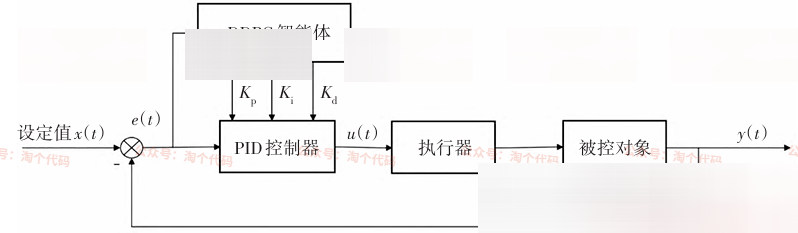
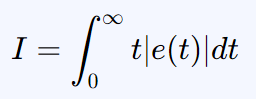
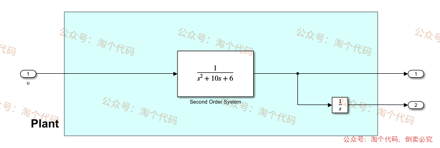
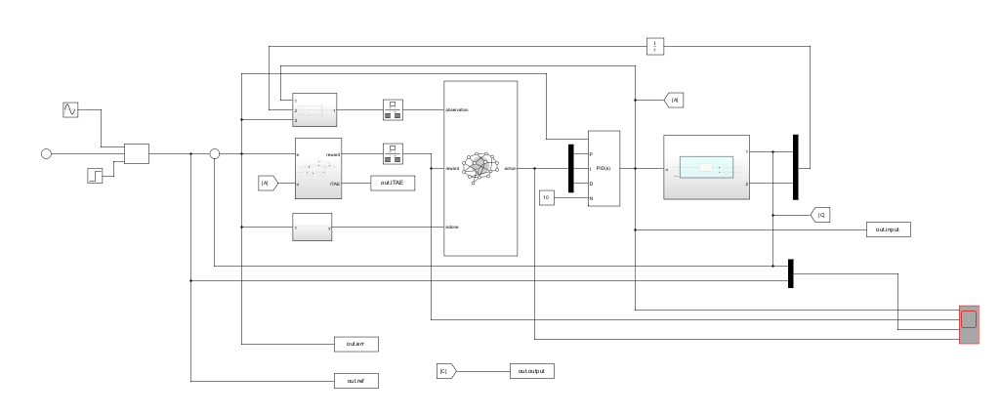
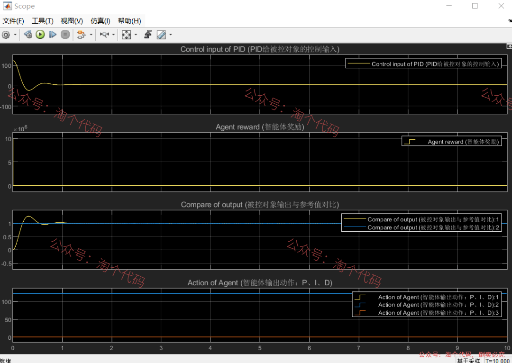
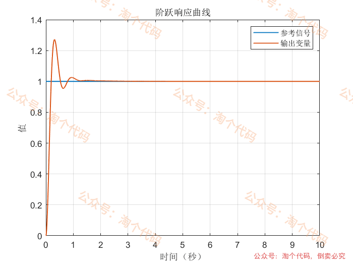
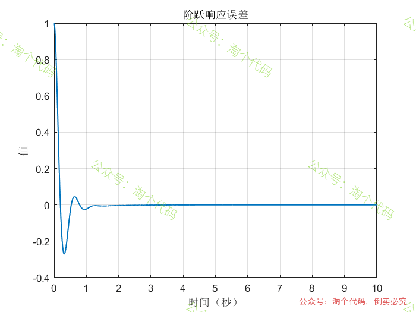
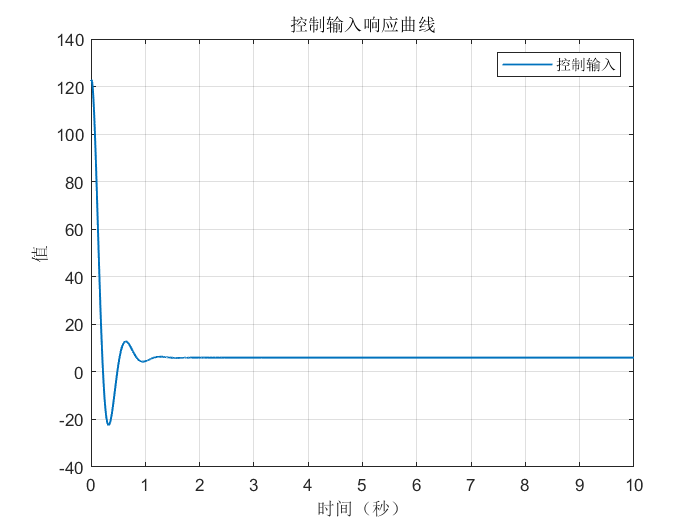
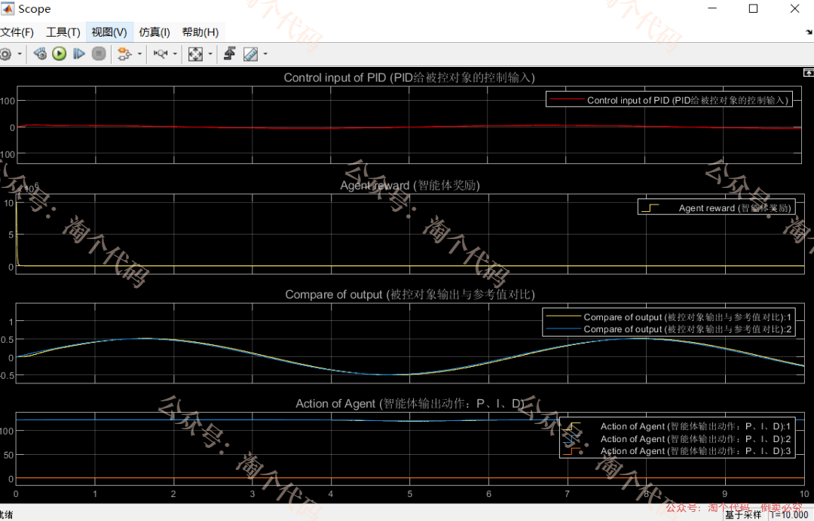
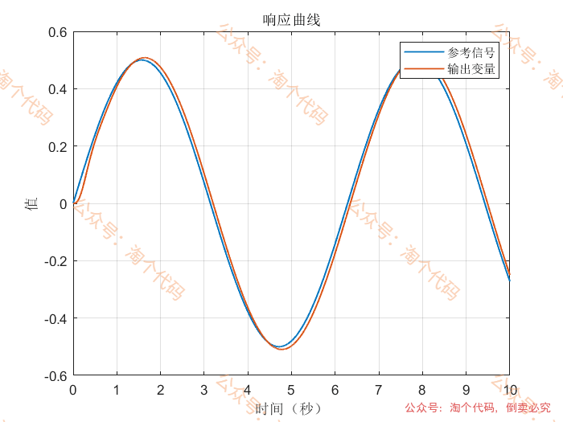
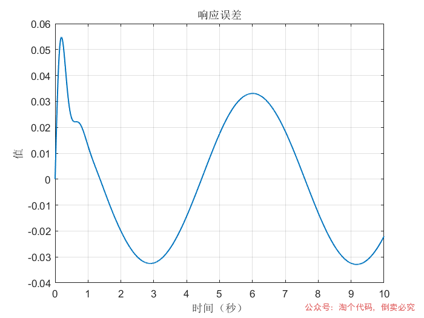
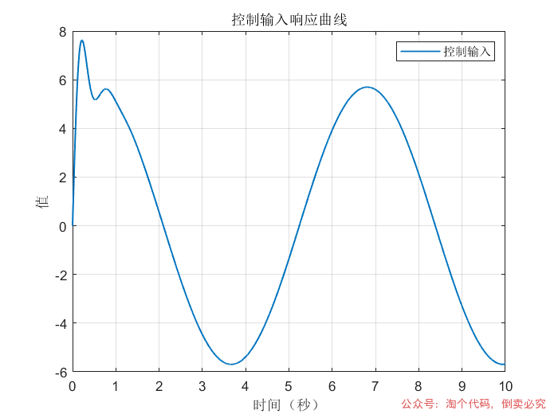
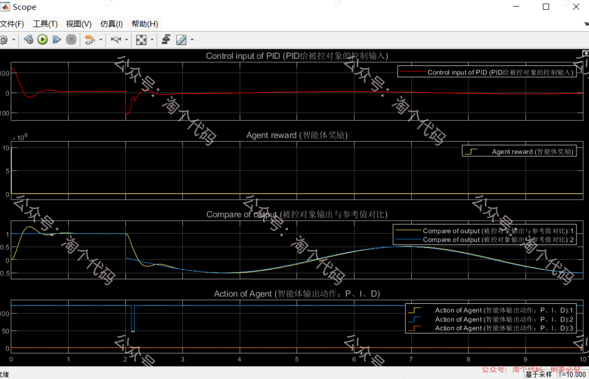
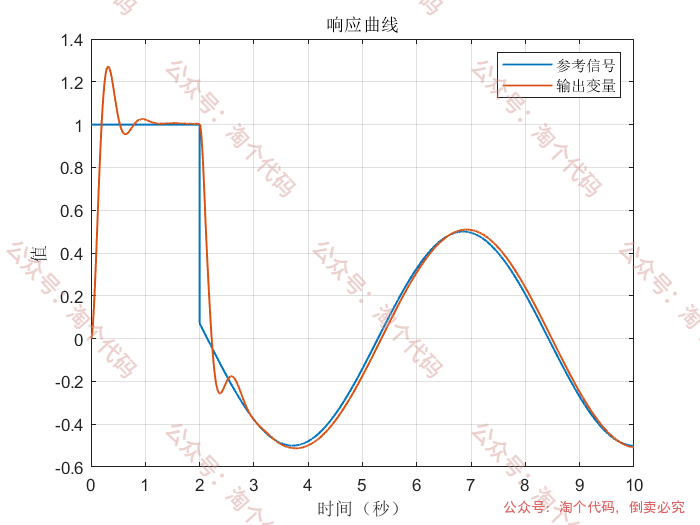
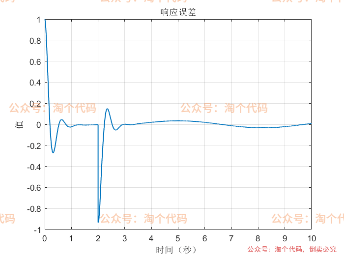
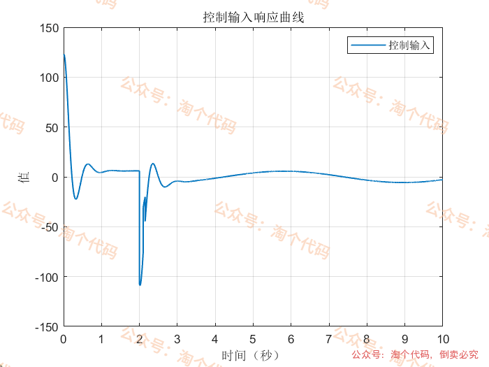
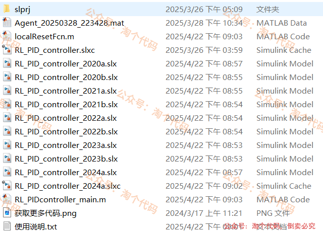

<!-- PAYMENT_BLOCK -->

## Get this dataset

- Payment link (Stripe): [Buy now](https://buy.stripe.com/3cs8yP7sY87d0vu9AB)
- Payment QR code: 

<!-- /PAYMENT_BLOCK -->
